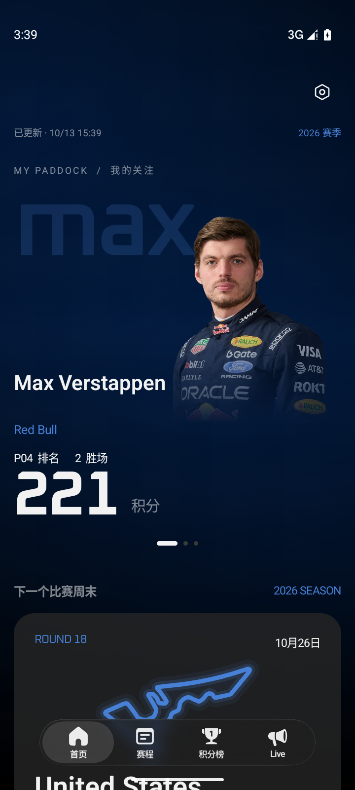
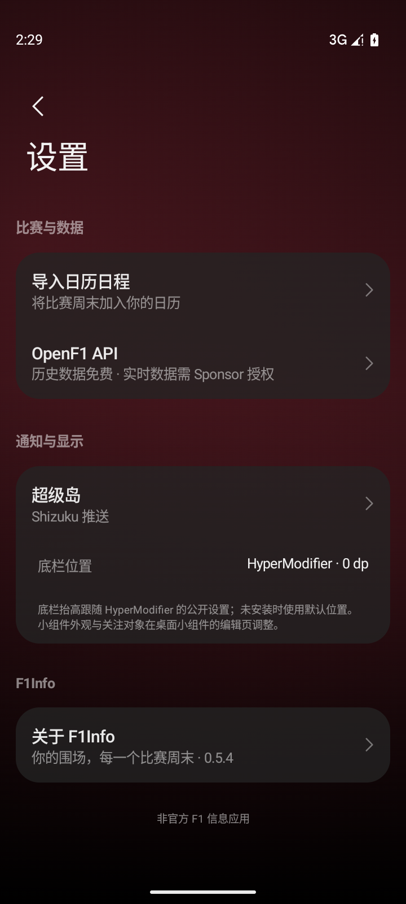
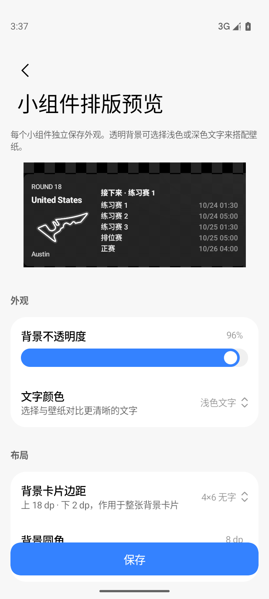

# F1Info

基于 **MIUIX 与柔光玻璃** 的非官方 Android F1 信息应用：赛程、积分榜、比赛结果、Live 动态和桌面小组件。

当前版本 **0.5.6**，包名 `com.aritxonly.f1info`，支持 **Android 13 及以上**。

<p>
  
  
  
</p>

## 功能

- **首页**：两位关注车手和一支车队的积分轮播，车队品牌浮光、下一场大奖赛与比赛周末安排。
- **赛程**：全部、即将举行和已结束比赛；赛道轮廓与资料、当地时间转换、比赛结果。
- **积分榜**：车手与车队排名，肖像、车队标识、车号和赛车图；详情中管理关注。
- **Live**：OpenF1 场次选择、排名与赛会动态，区分实时、历史与过期数据。赛中实时接口需要 OpenF1 Sponsor 授权。
- **超级岛**：主动开启后台关注；小米 HyperOS 上支持 Root / Shizuku 模式，其他设备使用动态通知。
- **日历**：导入剩余赛季、整个赛季或单个大奖赛，可选正赛或全部场次；重复导入更新原日程，支持无需日历权限的 ICS 导出。
- **小组件**：赛程 2×2 / 4×2 / 4×4、关注车手 2×2、车手榜与车队榜 4×2 / 4×4。各实例独立配置透明度、文字颜色、关注车手、背景卡片上下边距和圆角。
- **离线与刷新**：Jolpica 数据缓存、进入应用自动刷新、MIUIX 下拉刷新；图片使用内存/磁盘缓存和内置回退。

应用使用 MIUIX 控件与语义色板；品牌色为强调色，没有 Material / Monet 生成色板。柔光玻璃与分组卡片沿用 Deadliner，沉浸浮光参考 HyperModifier，视觉层次参考 BoxBox。数字强调采用 Oxanium 字体。底栏位置可跟随 HyperModifier 的公开设置。

## 构建

需要 **JDK 21、Android SDK Platform 37**。项目使用 Gradle Wrapper 9.3.1、AGP 9.1.1、Kotlin 2.4.10 和 MIUIX 0.9.4-rc01。

```sh
git clone git@github.com:AritxOnly/F1Info.git
cd F1Info
```

Android Studio 可以自动生成 `local.properties`，也可以自行配置：

```properties
sdk.dir=/path/to/Android/sdk
```

```sh
./gradlew :app:assembleDebug :app:testDebugUnitTest :app:lintDebug
```

Debug APK 位于 `app/build/outputs/apk/debug/app-debug.apk`，不需要发行者的签名文件或 OpenF1 账号。数据接口在运行时访问；历史数据不需要登录。

### Release 签名

签名是可选配置；没有配置时，`./gradlew :app:assembleRelease` 产出未签名 APK。

如果需要签名，复制 `signing.properties.example` 为 `signing.local.properties`，配置自己的 keystore 路径与凭据。也可通过 `-Pf1info.signingProperties=/path/to/private.properties` 指定外部配置文件。

```sh
./gradlew :app:assembleRelease
```

签名密钥、本机 SDK 路径与凭据均不进入 Git。官方发行证书的公开摘要见 [docs/release-signature.txt](docs/release-signature.txt)；自行构建的不同签名 APK 无法直接覆盖官方安装包。

## 小组件设置

背景卡片上下边距作用于整张卡片，内容保留独立内边距：

| 预设 | 上 / 下边距 |
| --- | --- |
| 默认 | 0 / 0dp |
| 4×6 | 16 / 2dp |
| 4×7 无字 | 12 / 0dp |
| 4×6 无字 | 18 / 2dp |
| 自定义 | 单侧 0–28dp，合计不超过 40dp |

背景圆角可设为 8–32dp，默认 22dp。详情见 [docs/WIDGETS.md](docs/WIDGETS.md)。先在应用加载数据，再添加桌面小组件。小组件展示最近缓存数据，不提供实时遥测。

## 数据与权限

Jolpica 提供赛程、积分与成绩；OpenF1 提供比赛动态。账号与令牌在本机加密保存，不上传给 F1Info 自建服务器。背景关注需通知权限；系统日历读写只在选择日历时请求；ICS 导出不需要日历权限。

时间按设备时区显示，未知时间不编造。日历结束时间为明确标注的估算，赛程变更需手动重新导入。赛程分类以正赛开始后约三小时作为结束窗口；赛道几何与资料可能不同于当前赛季布局。Root / Shizuku 超级岛功能需要用户授权，并保留网络恢复入口。

## 项目结构与验证

- `app/src/main/java/com/aritxonly/f1info/`：数据、模型、MIUIX UI、小组件、日历与通知模块。
- `app/src/test/`：单元测试。
- `app/src/debug/`：仅 Debug 可用的真实 RemoteViews 预览验证入口。
- `specs/`：功能规格、模块计划与任务记录。
- `docs/`：上游来源、构建验收与实际界面截图。

最近验收：45 项单元测试通过，Release/Debug 构建通过；记录见 [0.5.6 验证](docs/build-validation-0.5.6.md)。

## 开源与致谢

应用源代码遵循 [GPL-3.0](LICENSE)。第三方代码、字体和媒体保留原有许可与归属，详见 [NOTICE.md](NOTICE.md) 与 [来源记录](docs/UPSTREAM.md)。

感谢 Deadliner、HyperModifier、MIUIX、Jolpica F1、OpenF1、f1-circuits、AndroidLiquidGlass 与字体作者。Formula 1、车队标识和车手肖像属于原权利方；源码许可证不授予这些媒体的商标或肖像权。本应用不隶属于 Formula 1 或任何车队。
