# 小组件 0.5.6

长按桌面小组件选择编辑，可以查看真正的 Glance RemoteViews 渲染。先加载一次真实数据，再添加到桌面；长按赛程或积分榜组件调整大小。

| 类型 | 尺寸 | 内容 |
| --- | --- | --- |
| 赛程 | 2×2 | 赛道图、最近一场练习／排位／冲刺／正赛的时间 |
| 赛程 | 4×2 | 左侧赛道、右侧全周末安排 |
| 赛程 | 4×4 | 上部赛道与周末安排，下部后续四站 |
| 关注车手 | 2×2 | 肖像、排名、积分、胜场；每个实例独立选择车手 |
| 车手榜／车队榜 | 4×2 | 左侧领先者肖像／标识，右侧前三 |
| 车手榜／车队榜 | 4×4 | 上部领先者图像与积分，下部排名列表 |

列表行数按实际桌面高度变化，时间按设备时区显示，缺失数据明确标注。基础色使用 MIUIX 原生中性明暗色板；背景圆角默认22dp，可自定义8–32dp，渐变回容器背景。

## 自定义背景透明度

在桌面小组件的独立编辑页调节 MIUIX 滑块，支持 0–100% 背景不透明度。默认 96%；设置会按实例持久保存并立即刷新该小组件，文字、肖像、赛道图与车队标识保持原有透明度。真实 RemoteViews 预览也采用相同设置。

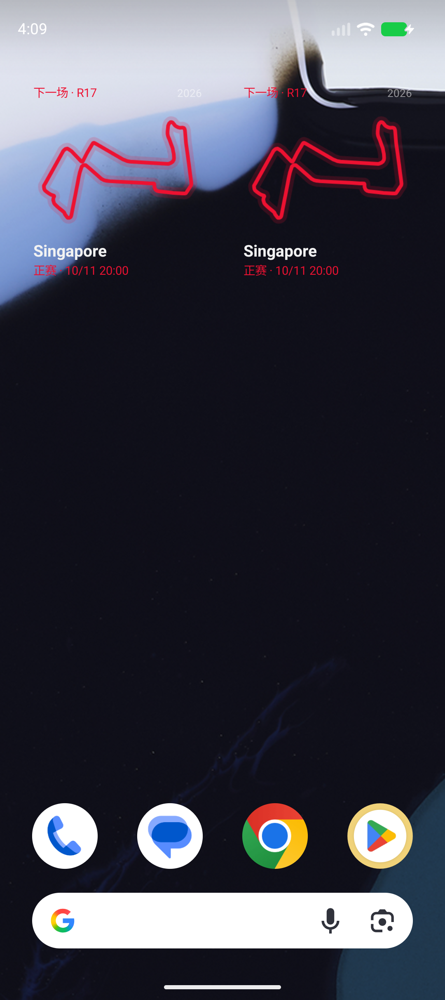
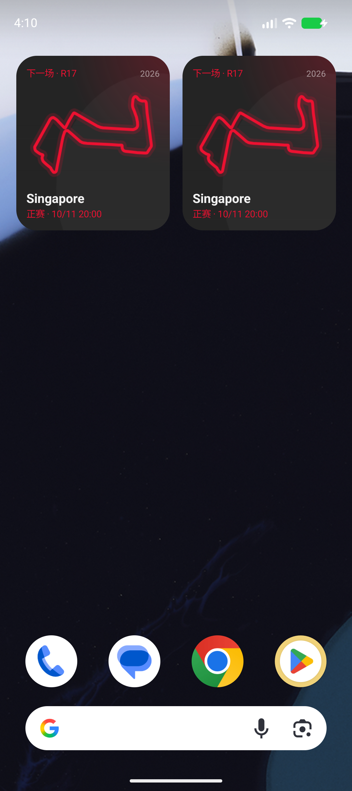

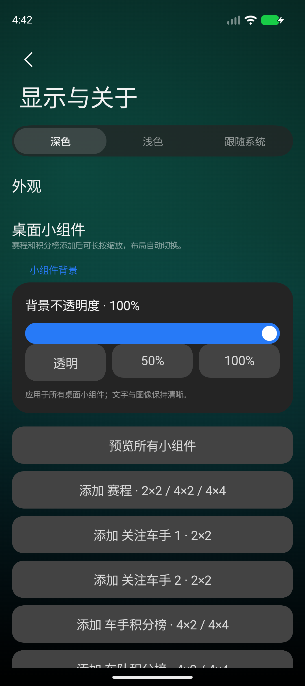

## 实际预览截图

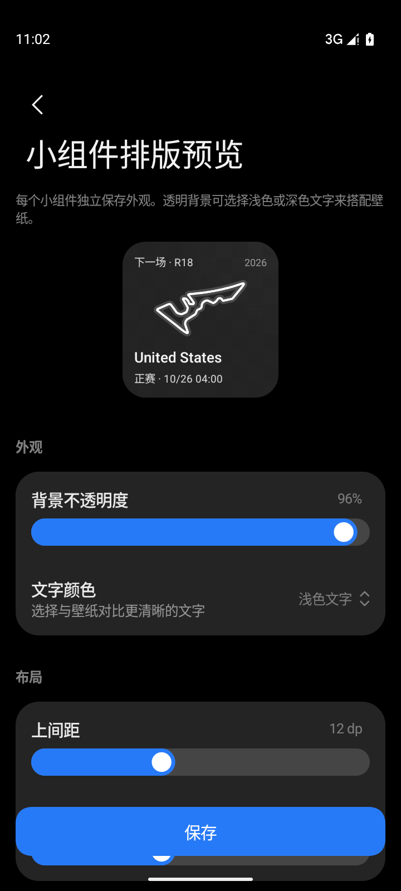
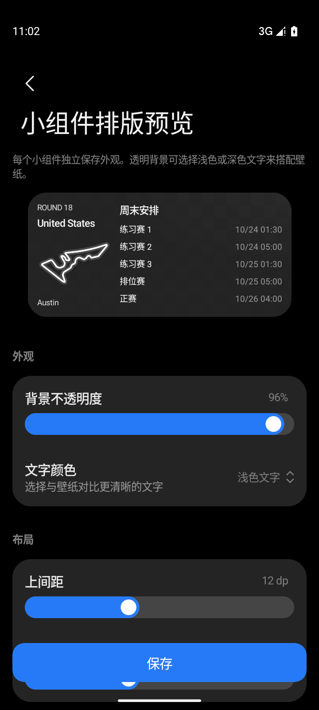
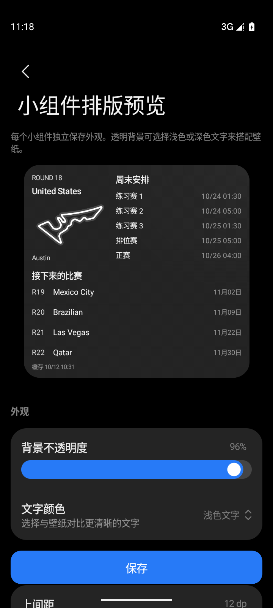
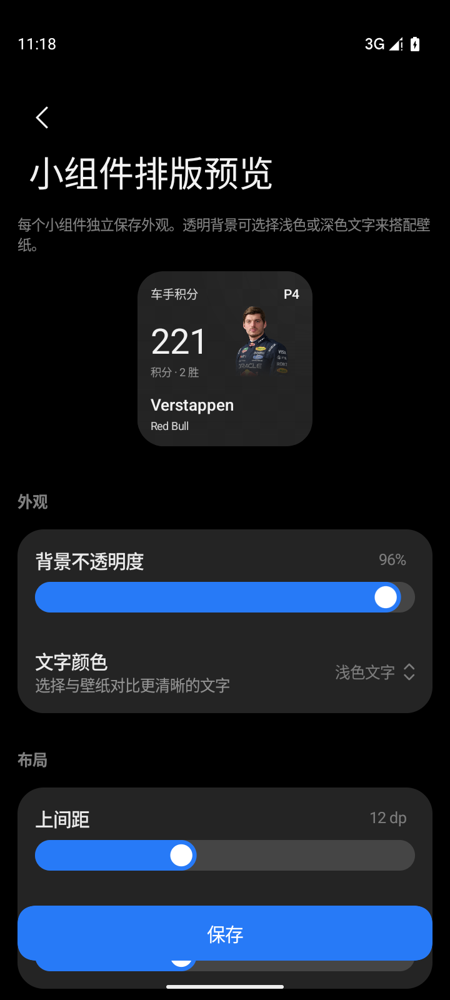
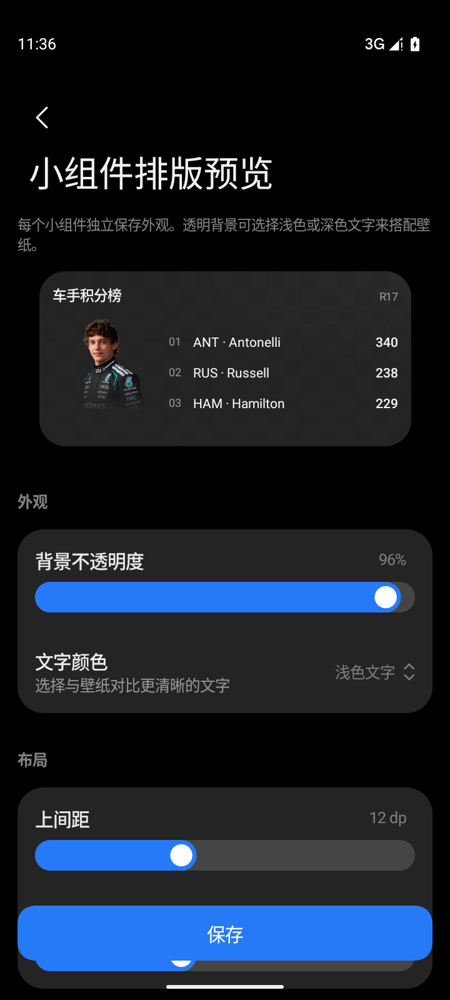
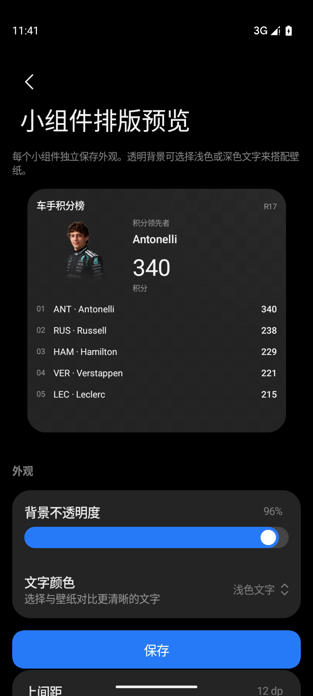
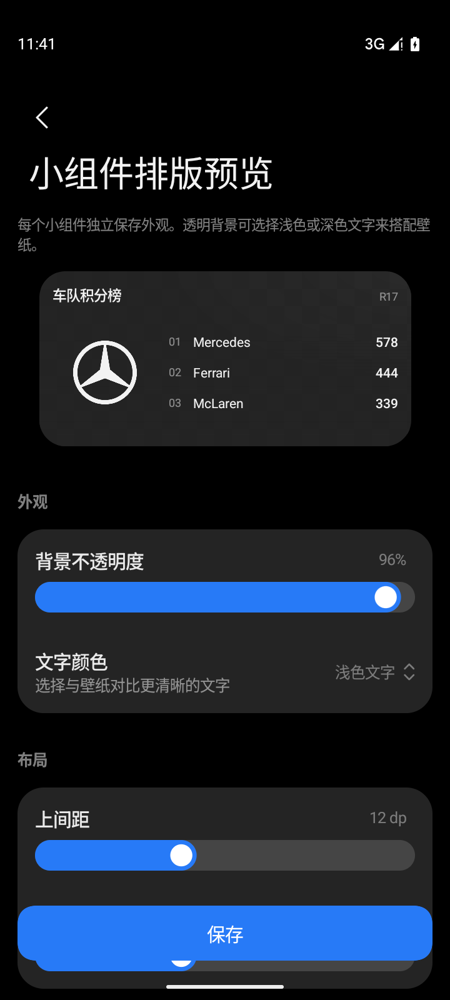
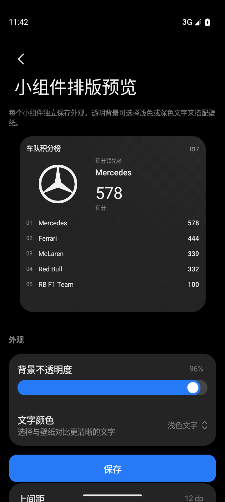
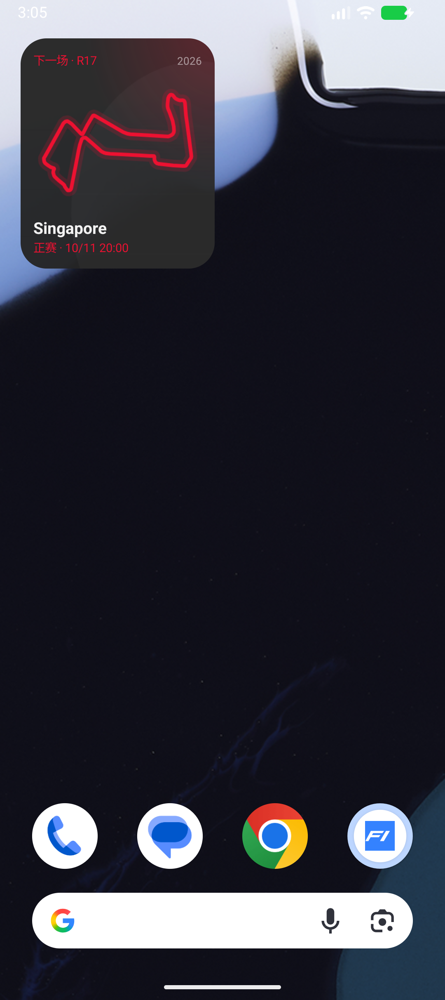

## 0.4.0 独立入口与编辑

赛程提供独立 2×2、4×2、4×4，车手/车队榜各有 4×2、4×4；车手肖像积分统一为 2×2 入口。旧实例不删除。小米编辑入口从 Deadliner 迁移，miuiEditUri 使用当前 widget ID；Android 标准 configure/reconfigure 同时支持。

每个实例独立保存背景不透明度、上下间距、浅色/深色文字。车手组件可选择任意当前赛季车手或跟随首页关注。编辑页实际 Glance 预览实时更新。中性 MIUIX 灰底替换品牌色大面积底色，字号保持层次，重点使用 Medium、数字采用 Normal。透明背景搭配壁纸时手动选择对比更好的文字颜色。

## 0.5.1 排版与编辑
编辑页将外观、布局、车手分组：SliderPreference 调整不透明度与上下间距，OverlayDropdownPreference 选择浅色/深色文字与车手，保留一个保存按钮。榜单与赛程使用对齐的列，姓名/章节用 Medium，数字与辅助信息用 Normal；车手 2×2 将肖像与积分左右分列，姓名独占底部行。组件仍采用中性 MIUIX 背景与文字，支持透明壁纸对比配置。

4×4 的领先者区与周末安排按系统字号增高，列表按可用高度显示；在大字号下保留完整说明与时间。编辑预览的棋盘底色也使用对应的 MIUIX 浅色/深色表面，方便检查透明文字。

编辑页随系统明暗变化，直接采用 MIUIX 原生色板和组件 Defaults；分组与背景不再叠加品牌色或浮光。

## 0.5.6 背景卡片边距

背景卡片与内容共同预留上下外边距，内部固定12dp安全间距。默认0/0；4×6为16/2；4×7无字12/0；4×6无字18/2。自定义单侧0–28dp，合计最多40dp，切换预设保留自定义数值。背景圆角8–32dp，各实例独立保存。
